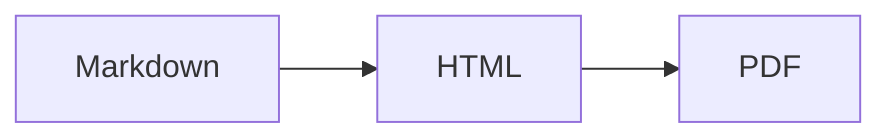

# kumihan4md (`kumi`)
[](https://github.com/yoshihicode/kumihan4md/releases/latest)


> **Kumihan (組版)** is the Japanese word for *typesetting* — the craft of arranging text and images into well-formed pages.

`kumi` is a CLI tool that typesets Markdown into page-break-aware PDFs, with first-class support for Japanese documents.

## ⚙️ Features
* **📄 Page-Break Aware:** Manual page breaks, a page break before each chapter (h1), no page break right after a heading, and code blocks, blockquotes, images and table rows that stay on one page.
* **🔁 Repeated Table Headers:** When a table spans multiple pages, its header row is repeated on each page.
* **🎨 Syntax Highlighting:** Code blocks are highlighted with [chroma](https://github.com/alecthomas/chroma), and you can choose the style.
* **📑 Table of Contents & Bookmarks:** Generates a clickable table of contents and PDF bookmarks (outline) from your headings.
* **🏷️ Cover Page:** Builds a cover page from the YAML front matter.
* **🔢 Page Numbers:** Page numbers appear in the footer. The cover page is not counted.
* **🩺 Environment Check:** `kumi -check` verifies that Chrome/Chromium and Japanese fonts are installed.
* **🖥️ Cross-Platform:** Available for Windows, macOS, and Linux.

Markdown is converted with [goldmark](https://github.com/yuin/goldmark) (GFM, footnotes, CJK, front matter), and the PDF is printed by headless Chrome through [chromedp](https://github.com/chromedp/chromedp).

## ✅ Requirements
* **Google Chrome / Chromium** (131 or later is recommended; see Known Limitations below)
* **Japanese fonts**

After installing, run `kumi -check` to verify your environment.

### 🐧 Linux (Debian / Ubuntu / WSL)
```bash
# Google Chrome
wget https://dl.google.com/linux/direct/google-chrome-stable_current_amd64.deb
sudo apt install -y ./google-chrome-stable_current_amd64.deb

# Japanese fonts
sudo apt install -y fonts-noto-cjk
```
On WSL, use the .deb version of Google Chrome rather than the snap version of Chromium.

### 🍎 macOS
```bash
# Google Chrome
brew install --cask google-chrome
```
Japanese fonts are built into macOS, so no extra installation is needed.

### 🪟 Windows
```powershell
# Google Chrome
winget install -e --id Google.Chrome
```
Japanese fonts are built into Windows, so no extra installation is needed.

If Chrome is installed in a non-standard location, specify it with `-chrome <path>`.

## 💾 Download
Download prebuilt binaries from the latest release:  
👉 [Get the latest binaries](https://github.com/yoshihicode/kumihan4md/releases/latest)

## 📦 Installation
### 🐧 Linux
```bash
wget https://github.com/yoshihicode/kumihan4md/releases/latest/download/kumihan4md_linux_amd64.tar.gz
tar -xzvf kumihan4md_linux_amd64.tar.gz
sudo mv kumi /usr/local/bin/

# Run
kumi sample.md
```

### 🍎🍺 macOS / Homebrew
```bash
brew tap yoshihicode/tap
brew install kumihan4md

# Run
kumi sample.md
```

### 🪟 Windows
```powershell
Invoke-WebRequest -OutFile kumihan4md_windows_amd64.tar.gz https://github.com/yoshihicode/kumihan4md/releases/latest/download/kumihan4md_windows_amd64.tar.gz
tar -xzvf kumihan4md_windows_amd64.tar.gz

# Run
.\kumi.exe sample.md
```

### 🐹 go install
```bash
go install github.com/yoshihicode/kumihan4md/cmd/kumi@latest
```

## 🚀 Quick Start
```bash
kumi sample.md                              # writes sample.pdf
kumi -cover -toc doc.md                     # add a cover page and a table of contents
kumi -hl-style monokailight doc.md          # change the highlighting style
kumi -o out.pdf -size "A4 landscape" doc.md # set the output path and paper size
kumi -html debug.html doc.md                # save the intermediate HTML for debugging
```

### 🩺 Environment Check
`kumi -check` checks the runtime environment and exits. It returns exit code 1 if a required item is missing, so you can use it in scripts. `kumi -h` also prints the check results at the end of the help.

```
Environment check:
  [OK]   Chrome/Chromium (required): /usr/bin/google-chrome (Google Chrome 131.0.6778.85)
  [NG]   Japanese fonts (required): not found (text will be rendered as empty boxes)
         → sudo apt install -y fonts-noto-cjk
```

### 🏷️ Front Matter
```yaml
---
title: Proposal Title        # cover page and PDF title (-title takes precedence)
subtitle: Subtitle
author: Author Name
organization: Company Name
date: 2026-11-20             # shown as "November 20, 2026"; quote it ("2026年11月20日") to show it as written
version: "1.0"               # quote it, or it becomes the number 1
cover: true                  # same as -cover
cover_labels:                # cover labels (default: Version / Date / Author)
  version: 版
  date: 日付
  author: 作成者
toc: true                    # same as -toc
---
```


### 📊 Mermaid Diaglam
If you specify “mermaid” as the language for a code block, that code block will be displayed as a diagram.
````

````

#### Fields
| Field | Type | Description | Note |
| --- | --- | --- | --- |
| title | string | Document title | `-title` takes precedence. If no title is set, the first h1 is used. |
| subtitle | string | Subtitle on the cover page | |
| author | string | Author on the cover page | |
| organization | string | Organization on the cover page | |
| date | string / date | Date on the cover page | An unquoted date is formatted as `January 2, 2006`. |
| version | string | Version on the cover page | Quote it, e.g. `"1.0"`. |
| cover | bool | Generate a cover page | Same as `-cover` |
| cover_labels | map | Cover labels (`version`, `date`, `author`) | `-cover-labels` takes precedence. |
| toc | bool | Generate a table of contents | Same as `-toc` |

## 📐 Page Breaks
| Type | Behavior |
| --- | --- |
| Manual | Write one of `<!-- pagebreak -->`, `\pagebreak` or `\newpage` on a line by itself. Markers inside code blocks are ignored. |
| After cover / TOC | A page break is inserted automatically. |
| Chapters | A page break is inserted before every h1 except the first (default). Use `-h1-break=false` to turn this off. |
| Headings | No page break right after a heading. |
| No splitting | Code blocks, blockquotes, images and table rows are not split across pages (unless they are taller than a page). |
| Tables | The header row is repeated on each page. |
| Keep with next | With `-keep-lines 3`, a heading moves to the next page if fewer than 3 lines of space remain below it. Use `-keep-levels` to choose the heading levels (default `2,3`). |

## 📑 Table of Contents
Use `-toc` to generate a table of contents. Put `<!-- toc -->` or `[[toc]]` on a line by itself to place it there; otherwise it goes at the top. Each entry links to its heading. Use `-toc-depth` to set the depth and `-toc-title` to set the heading text.

## 📘 Usage
```
Usage: kumi [options] input.md

Options:
  -check
        check the runtime environment (Chrome, Japanese fonts) and exit
  -chrome string
        path to the Chrome/Chromium executable (default: auto-detect)
  -cover
        generate a cover page from the front matter
  -cover-labels string
        cover labels as key=value pairs (keys: version, date, author; e.g. "version=版,date=日付,author=作成者")
  -css string
        additional CSS file (loaded after the default CSS)
  -h1-break
        insert a page break before every h1 except the first (default true)
  -hl-style string
        syntax highlighting style (chroma style name, "none" to disable) (default "github")
  -html string
        save the intermediate HTML to the given path (for debugging)
  -keep-levels string
        heading levels affected by -keep-lines (comma-separated, 1-6) (default "2,3")
  -keep-lines int
        move a heading to the next page if fewer than N lines of space remain below it (0 to disable)
  -o string
        output PDF path (default: input file name with .pdf)
  -outline
        generate PDF bookmarks (outline) from headings (default true)
  -page-number
        show page numbers in the footer (default true)
  -size string
        paper size (e.g. "A4", "A4 landscape", "B5", "Letter") (default "A4")
  -timeout duration
        conversion timeout (default 1m0s)
  -title string
        document title (default: front matter title, then the first h1)
  -toc
        generate a table of contents (at <!-- toc --> if present, otherwise at the top)
  -toc-depth int
        maximum heading level included in the TOC (1-6) (default 3)
  -toc-title string
        TOC heading text (default "目次")
  -version
        print version and exit
```

## ⚠️ Known Limitations
* **No page numbers in the TOC.** Chrome does not support CSS `target-counter()`.
* **Page numbers require Chrome 131 or later.** They are drawn with CSS `@page` margin boxes. Older versions show no numbers, and `kumi -check` warns about this.
* **The total page count is not shown.** It would include the cover page and would not match the body page numbers.
* **PDF bookmarks require a recent Chrome.** Older versions may not generate them.

## 🛠️ Build from Source
```bash
git clone https://github.com/yoshihicode/kumihan4md.git
cd kumihan4md
go build -o kumi ./cmd/kumi
./kumi sample.md
```

### Project Structure
```
kumihan4md/
├── cmd/
│   └── kumi/            # entry point: flags, help, -check
└── internal/
    ├── app/             # overall flow (Markdown → HTML → PDF)
    ├── markdown/        # preprocessing (page-break / TOC markers), HTML conversion, TOC, front matter, highlighting
    ├── page/            # print-ready HTML (CSS, cover page, page numbers, -keep-lines)
    │   └── assets/      # style.css / template.html (embedded with go:embed)
    ├── pdf/             # prints HTML to PDF with chromedp
    └── envcheck/        # runtime environment check (Chrome, Japanese fonts)
```

> **Note:** `internal/pdf` imports only chromedp (v0.24 or later), not cdproto. Importing cdproto directly can pull in a version that does not match chromedp and break the build.
