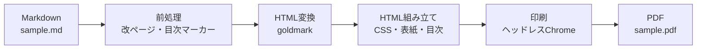

<!-- toc -->

# はじめに

改ページ制御の確認用ドキュメントです。

## 表（ページをまたぐとヘッダ行が繰り返される）

| No | 項目 | 説明 |
|---:|------|------|
| 1 | Go | Googleが開発した並行処理に強いコンパイル言語 |
| 2 | Python | 読みやすさを重視した汎用スクリプト言語 |
| 3 | JavaScript | Webブラウザで動作するスクリプト言語 |
| 4 | TypeScript | JavaScriptに静的型付けを加えた言語 |
| 5 | Java | JVM上で動作するオブジェクト指向言語 |
| 6 | C | OSや組込みで使われる手続き型言語 |
| 7 | C++ | Cを拡張したオブジェクト指向言語 |
| 8 | C# | Microsoftが開発した.NET向け言語 |
| 9 | Rust | メモリ安全性を重視したシステム言語 |
| 10 | Ruby | 日本発のオブジェクト指向スクリプト言語 |
| 11 | PHP | Webサーバサイド向けスクリプト言語 |
| 12 | Swift | Appleプラットフォーム向けの言語 |
| 13 | Kotlin | JVM上で動作しAndroid開発で使われる言語 |
| 14 | Scala | オブジェクト指向と関数型を融合したJVM言語 |
| 15 | Haskell | 純粋関数型プログラミング言語 |
| 16 | Perl | テキスト処理に強いスクリプト言語 |
| 17 | Lua | 組込み用途の軽量スクリプト言語 |
| 18 | R | 統計解析向けの言語 |
| 19 | Julia | 科学技術計算向けの高速な言語 |
| 20 | Dart | Flutterで使われるGoogle製の言語 |
| 21 | Elixir | Erlang VM上で動作する関数型言語 |
| 22 | Erlang | 高可用な分散システム向けの関数型言語 |
| 23 | Clojure | JVM上で動作するLisp系言語 |
| 24 | Zig | Cの代替を目指すシステム言語 |
| 25 | Fortran | 数値計算向けの歴史ある言語 |
| 26 | COBOL | 事務処理向けの歴史ある言語 |

## コードブロック（ハイライト付き・途中で分割されない）

```go
package main

import "fmt"

func main() {
	fmt.Println("hello, kumihan4md") // コメント
}
```

```text
<!-- pagebreak -->
↑コードブロック内のマーカーは改ページされない
```

## 処理の流れ（Mermaid）



<!-- pagebreak -->

# 第2章

手動改ページで、この章は新しいページから始まります。

## 2.1 小見出し

本文。


# 第3章

章が違うので自動改ページ

## 3.1 小見出し

本文。